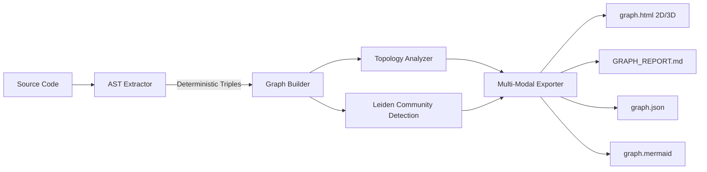

# 🪐 Graph-RAG: Deterministic Code Knowledge Graph & Precision Debugger

<div align="center">

[](LICENSE)
[](https://www.python.org/)
[](#features)
[](#)
[](skills/graph-rag/)

**Turn any codebase into a queryable, deterministic Knowledge Graph with 3D Galaxy visualization and multi-hop call chain tracing.**  
*Zero vector embeddings. Zero LLM API cost. 100% deterministic AST topology.*

[English](#overview) | [中文说明](#项目介绍)

</div>

---

## 🌟 Overview / 项目介绍

**Graph-RAG** is an ultra-fast, zero-dependency engine that transforms complex source code into an interactive, deterministic **Code Knowledge Graph**. 

Unlike probabilistic Vector RAG (which slices files into arbitrary chunks and suffers from hallucination and missed cross-file relationships), Graph-RAG uses **AST (Abstract Syntax Tree)** parsing and **graph modularity algorithms (Leiden/Louvain)** to construct a verifiable ground truth of your entire architecture.

Equipped with an **Interactive 3D Galaxy Viewer** and an automated **OpenCode / Claude Code Skill**, Graph-RAG enables AI coding agents and developers to pinpoint bugs, trace upstream callers, and evaluate blast radius in milliseconds—**completely eliminating blind codebase grepping**.

---

## ⚡ Key Highlights / 核心特性

- 💎 **100% Deterministic & Verifiable (Zero Hallucination)**:  
  Every edge is strictly typed (`defines`, `calls`, `imports`) and tagged with confidence (`EXTRACTED` 1.0, `INFERRED` 0.55~0.95, `AMBIGUOUS`). No guesswork.
- 🪐 **3D Orbit Galaxy Visualization (0 External CDN)**:  
  Generates a single, self-contained `graph.html` featuring a 360° orbitable 3D planetary system, depth-of-field perspective, and fluid 2D/3D toggling.
- 🔗 **Multi-Hop Longitudinal Call Chain Tracing**:  
  Click any function/method to visually illuminate its 1~4 hop downstream execution flow with amber lightbeams, instantly exposing complex execution sequences ($A \rightarrow B \rightarrow C \rightarrow D$).
- 🧩 **Automated Subsystem Community Detection**:  
  Partitions codebases into decoupled architectural clusters using graph modularity optimization.
- 👑 **Architectural Insights & Flaw Detection**:  
  Instantly uncovers **God Nodes** (architectural bottlenecks), **Circular Dependencies** (import cycles), and **Orphan Nodes** (dead code).
- 🤖 **Native AI Agent Skill Ready**:  
  Includes a drop-in OpenCode / Claude Code skill in `skills/graph-rag/` with the `query_graph.py` precision diagnostic script.

---

## 📊 Comparison / 传统方案与 Graph-RAG 对比

| Dimension / 维度 | Traditional Grep / 全文搜索 | Vector RAG / 向量检索 | 🪐 Graph-RAG (本引擎) |
|---|---|---|---|
| **Underlying Principle** | Plain text string matching | Semantic similarity / Dot product | **Deterministic AST Topology & Property Graph** |
| **Token & API Cost** | Heavy token burn or manual reading | High embedding + vector DB costs | **$0 (Runs 100% locally in milliseconds)** |
| **Call Chain Tracing** | Unable to track multi-tier calls | Severely broken across file chunks | **Deep 1~4 Hop Chain Tracing with directional flow** |
| **Search Space** | Entire codebase (Hundreds of files) | Fragmented chunks with noise | **Shrinks search space by 95% to exact subgraphs** |
| **Safety / Blast Radius** | High risk of breaking unseen callers | Blind to indirect dependencies | **Precise in-degree / out-degree blast radius check** |

---

## 🚀 Quick Start / 快速开始

### 1. Installation / 安装

```bash
# Clone the repository
git clone https://github.com/yanlinbao926/Graph-RAG.git
cd Graph-RAG

# Optional: Install in editable mode for the global `graph-rag` CLI
pip install -e .
```
*(Graph-RAG core uses only Python standard library—zero heavy dependencies required!)*

### 2. Scan a Codebase / 扫描代码库

```bash
# Scan any directory or repository
python -m graph_rag /path/to/your/project --output ./graph_rag_out

# Or via installed CLI command:
graph-rag /path/to/your/project --output ./graph_rag_out
```

### 3. Generated Artifacts / 输出产物

Graph-RAG produces 4 standard multimodal outputs in the output directory:
- 🌐 `graph.html`: Interactive 2D/3D Galaxy Explorer. Open directly in any browser (no server needed).
- 📊 `GRAPH_REPORT.md`: Architectural diagnostic report highlighting God Nodes, Communities, and Circular Dependencies.
- 📋 `graph.json`: Industrial standard Node-Link JSON (100% compatible with D3.js, NetworkX, and Neo4j).
- 📐 `graph.mermaid`: Ready-to-render topological flowchart for documentation.

---

## 🤖 Using as an OpenCode / AI Agent Skill

Graph-RAG comes with a battle-tested agent skill for precision debugging:

1. Copy the skill to your OpenCode or Claude config directory:
```bash
# For OpenCode
cp -r skills/graph-rag ~/.config/opencode/skills/
```

2. When an error occurs, query the graph directly instead of blind grepping:
```bash
python skills/graph-rag/scripts/query_graph.py "function_or_symbol_name" --graph ./graph_rag_out/graph.json
```

**Diagnostic Output:**
```text
🎯 [Target Symbol]: OrderController.create_order (method)
   - Location: examples/demo_app/main.py:14
   - Subsystem: Cluster #1 (Order Management)
   - Degree: 5 (Ordinary Business Node)

🔍 [Upstream Callers] (Who triggers this):
   ▲ [calls] main ➔ examples/demo_app/main.py:24

⚡ [Downstream Dependencies] (Who does this call):
   ▼ [calls] PaymentService.charge ➔ examples/demo_app/services.py:9
   ▼ [calls] OrderRepository.save_order ➔ examples/demo_app/services.py:27
   ▼ [calls] NotificationService.send_email ➔ examples/demo_app/services.py:22
```

---

## 🛠️ Architecture / 系统架构



---

## 📄 License

This project is licensed under the [Apache License 2.0](LICENSE).
Distributed under the terms of the Apache-2.0 license.
