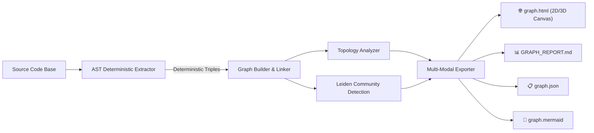

# 🪐 Graph-RAG: Deterministic Code Knowledge Graph & Precision Debugger

<div align="center">

[](LICENSE)
[](https://www.python.org/)
[](#features)
[](#)
[](skills/graph-rag/)

**Turn any codebase into a queryable, deterministic Knowledge Graph with 3D Galaxy visualization and multi-hop call chain tracing.**  
*Zero vector embeddings. Zero LLM API cost. 100% deterministic AST topology.*

[English](README.md) | [简体中文](README_zh.md)

</div>

---

## 🌟 Overview

**Graph-RAG** is an ultra-fast, zero-dependency engine that transforms complex source code into an interactive, deterministic **Code Knowledge Graph**.

### Why Vector RAG Fails for Source Code
Traditional code retrieval typically relies on Vector RAG (slicing source code into text chunks and calculating semantic embeddings):
- **Fragmented Context**: Functions, classes, and imports are sliced arbitrarily, destroying call dependencies across multiple files.
- **Hallucinations & Inexactness**: Semantic vector similarity frequently confuses similar variable names or unrelated boilerplate logic.
- **Blind to Multi-Hop Call Chains**: A user request like *"Where does the upload endpoint invoke the Excel parser?"* spans 3 to 5 hops across different layers, which vector search completely misses.
- **High Cost & Latency**: Generating vector embeddings requires heavy LLM token expenditure and dedicated vector databases.

### The Graph-RAG Paradigm
Graph-RAG uses **AST (Abstract Syntax Tree)** static analysis and **graph modularity algorithms (Leiden/Louvain)** to construct a verifiable ground truth of your entire architecture. Every edge is strictly typed (`defines`, `calls`, `imports`, `inherits`) with confidence scoring.

Equipped with a standalone **Interactive 3D Galaxy Viewer** and an automated **OpenCode / Claude Code Agent Skill**, Graph-RAG enables developers and AI agents to pinpoint bugs, trace upstream callers, and evaluate blast radius in milliseconds—**completely eliminating blind codebase grepping**.

---

## ⚡ Key Highlights

- 💎 **100% Deterministic & Verifiable (Zero Hallucination)**:  
  Every relationship is extracted via AST and tagged with explicit confidence levels:
  - `EXTRACTED` (1.0): Direct syntactic definition/call.
  - `INFERRED` (0.55 ~ 0.95): Contextual symbol resolution across modules.
  - `AMBIGUOUS` (0.5): Dynamic dispatch or multiple candidates flagged for audit.
- 🪐 **Interactive 3D Orbit Galaxy Viewer (Zero CDN / Standalone)**:  
  Generates a single self-contained `graph.html` featuring full 360° orbital rotation, depth-of-field perspective, real-time physics simulation, and fluid 2D/3D toggling. Works completely offline.
- 🔗 **Deep Multi-Hop Call Chain Tracing**:  
  Click any function or method to visually illuminate its 1~4 hop downstream execution flow with amber lightbeams, instantly exposing complex execution sequences ($A \rightarrow B \rightarrow C \rightarrow D$).
- 📍 **Interactive A-to-B Shortest Path Penetration**:  
  Input any two symbols (e.g. `standalone_chat_endpoint` and `robust_read_excel`) in `graph.html` or the CLI. Graph-RAG immediately illuminates the shortest path, rendering floating action capsules (`calls :L1479 ➔`), line numbers, and tool metadata on both canvas lines and step-by-step cards.
- 🧩 **Automated Subsystem Community Detection**:  
  Partitions codebases into decoupled architectural clusters using graph modularity optimization (Leiden/Louvain).
- 👑 **Architectural Insights & Flaw Detection**:  
  Instantly uncovers **God Nodes** (architectural bottlenecks), **Circular Dependencies** (import cycles), and **Orphan Nodes** (dead code).
- 🤖 **Native AI Agent Skill Ready**:  
  Includes a drop-in OpenCode / Claude Code skill in `skills/graph-rag/` with the `query_graph.py` precision diagnostic script.

---

## 📊 Comparison: Grep vs. Vector RAG vs. Graph-RAG

| Dimension | Traditional Grep / Full-Text | Vector RAG / Embeddings | 🪐 Graph-RAG (This Engine) |
|---|---|---|---|
| **Underlying Principle** | String/regex matching | Semantic vector similarity | **Deterministic AST Topology & Property Graph** |
| **Token & API Cost** | High manual review or heavy token burn | Expensive embedding & vector DB costs | **$0 (100% local static analysis in milliseconds)** |
| **Call Chain Tracing** | Cannot trace multi-tier calls | Severely broken across file chunks | **Deep 1~4 Hop Chain Tracing with directional flow** |
| **A ➔ B Path Tracing** | Manual guesswork across files | Completely unsupported | **Instant BFS shortest path with exact action labels** |
| **Search Space** | Entire codebase (Hundreds of files) | Fragmented chunks with noise | **Shrinks search space by 95% to exact subgraphs** |
| **Safety / Blast Radius** | High risk of breaking unseen callers | Blind to indirect dependencies | **Precise in-degree / out-degree blast radius check** |

---

## 🚀 Quick Start

### 1. Installation

```bash
# Clone the repository
git clone https://github.com/yanlinbao926/Graph-RAG.git
cd Graph-RAG

# Optional: Install in editable mode for the global `graph-rag` CLI
pip install -e .
```
*(Graph-RAG core uses only the Python standard library—zero external dependencies required!)*

### 2. Scan a Codebase

```bash
# Run via python module
python -m graph_rag /path/to/your/project --output ./graph_rag_out

# Or via installed global CLI:
graph-rag /path/to/your/project --output ./graph_rag_out
```

### 3. Generated Multimodal Artifacts

Graph-RAG produces 4 standard multimodal outputs in the specified output directory:

| File | Format | Description |
|---|---|---|
| 🌐 `graph.html` | HTML5 / Canvas | Self-contained 2D/3D interactive visualizer. Open directly in any browser. |
| 📊 `GRAPH_REPORT.md` | Markdown | Architectural diagnostic report detailing God Nodes, Leiden clusters, and cycles. |
| 📋 `graph.json` | JSON | Industrial standard Node-Link JSON (100% compatible with D3.js, NetworkX, and Neo4j). |
| 📐 `graph.mermaid` | Mermaid | Ready-to-render topological flowchart for documentation and GitHub previews. |

---

## 📍 Interactive A-to-B Shortest Path Penetration

Graph-RAG supports tracing the shortest execution route connecting any two symbols across multiple files and layers.

### Via Interactive Web Visualizer (`graph.html`)
1. Open `graph.html` in your browser.
2. Locate the **📍 A ➔ B Path Penetration** card in the left sidebar.
3. Enter Start **A** (e.g., `main` or `standalone_chat_endpoint`) and Target **B** (e.g., `robust_read_excel`).
4. Click **`⚡ Penetrate & Connect`**:
   - The entire galaxy dims, focusing on an amber glowing lightbeam traversing the exact path.
   - High-contrast floating action capsules (e.g., `[⚡ calls :L1479 ➔]`) appear directly on each canvas line segment.
   - The left panel displays each step with node kind, file location (`main.py:1450`), and tool description.

### Via Command-Line Interface (CLI)
```bash
# Using the built-in query tool (zero files opened)
python skills/graph-rag/scripts/query_graph.py "standalone_chat_endpoint" "robust_read_excel" --graph ./graph_rag_out/graph.json
```

**Output:**
```text
✨ [Shortest Path Found]: 3 hops (Zero files opened)
  #0 [function] main:standalone_chat_endpoint (main.py:1450)
     ── ⚡ calls (L1479) ──>
  #1 [method] services.data_engine:DataAnalysisEngine.build_fact_sheet (services/data_engine.py:560)
     ── ⚡ calls (L583) ──>
  #2 [method] services.data_engine:DataAnalysisEngine.load_dataframes (services/data_engine.py:530)
     ── ⚡ calls (L542) ──>
  #3 [function] services.visualizer:robust_read_excel (services/visualizer.py:25)
```

---

## 🤖 Using as an OpenCode / AI Agent Skill

Graph-RAG includes a battle-tested agent skill that instructs AI coding assistants (OpenCode, Claude Code, Cursor) to debug code with precision: **"Target the graph first, fix the root cause locally, never grep blindly."**

### 1. Register Skill
```bash
# For OpenCode: copy to global skill directory
cp -r skills/graph-rag ~/.config/opencode/skills/
```

### 2. Single-Symbol Diagnostic Workflow
When an exception stack trace or bug report arrives, the agent queries the symbol's blast radius:
```bash
python skills/graph-rag/scripts/query_graph.py "DataAnalysisEngine" --graph ./graph_rag_out/graph.json
```

**Diagnostic Output:**
```text
🎯 [Target Symbol]: DataAnalysisEngine (class)
   - Location: services/data_engine.py:18
   - Subsystem: Cluster #2 (Data Processing)
   - Degree: 28 (God Node Warning: Core Architecture Component)

🔍 [Upstream Callers] (Who invokes this component):
   ▲ [calls] standalone_chat_endpoint ➔ main.py:1479
   ▲ [calls] execute_report_workflow ➔ services/data_engine.py:840

⚡ [Downstream Dependencies] (What does this component invoke):
   ▼ [calls] robust_read_excel ➔ services/visualizer.py:25
   ▼ [calls] build_fact_sheet ➔ services/data_engine.py:560
```

---

## 🛠️ Architecture & Pipeline



---

## 📄 License

This project is licensed under the [Apache License 2.0](LICENSE).  
Distributed under the terms of the Apache-2.0 license.
