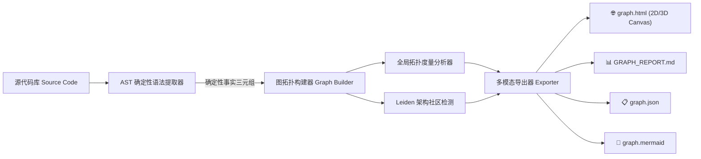

# 🪐 Graph-RAG: 确定性代码知识图谱引擎与精准溯源调试器

<div align="center">

[](LICENSE)
[](https://www.python.org/)
[](#-核心特性与技术亮点)
[](#)
[](skills/graph-rag/)

**将任意代码库一键转化为可交互、可查询的确定性代码知识图谱，支持 3D 宇宙星系可视化与纵向多跳调用链穿透。**  
*零向量嵌入（Zero Embeddings），零 LLM API 开销，100% 确定性 AST 语法树拓扑。*

[English](README.md) | [简体中文](README_zh.md)

</div>

---

## 🌟 项目概述

**Graph-RAG** 是一个超高速、零外部依赖的确定性代码知识图谱构建与分析引擎。

### 为什么传统的“向量检索 (Vector RAG)”在代码分析中频频失效？
现有的 AI 代码助手或文档检索大多依赖向量化切块方案（Chunking + Embedding）：
- **上下文断裂**：函数、类和导入依赖被机械切分为碎片，跨文件、跨模块的深层调用关系彻底丢失；
- **语义幻觉与误召回**：向量余弦相似度很容易被命名相似但无关的样板代码干扰，无法给出精确坐标；
- **对多跳调用链路完全失明**：当开发者或 AI 提问 *“上传接口究竟是通过哪几层调用到达 Excel 解析工具的？”*，此类跨越 3~5 层的纵向链路，向量检索根本无法还原；
- **巨额 Token 与数据库开销**：构建与更新向量索引需要消耗大量模型 Token，且依赖复杂的向量数据库。

### Graph-RAG 的确定性解决之道
Graph-RAG 采用 **AST (抽象语法树) 静态解析**与**图拓扑聚类算法 (Leiden/Louvain)**，从语法底层提取出 100% 确凿的代码事实三元组。每一条连线均具备强类型约束（如 `defines` 定义、`calls` 调用、`imports` 依赖、`inherits` 继承）以及三级置信度评分。

配套提供单文件免安装的 **3D 宇宙星系可视化交互器** 与原生 **OpenCode / Claude Code 技能**，让开发者与 AI Agent 能够在毫秒级内完成故障溯源与影响面评估——**彻底终结全代码库盲目 Grep 搜索 (No Blind Grepping)**。

---

## ⚡ 核心特性与技术亮点

- 💎 **100% 确定性与可验证（零幻觉）**：  
  所有关系均基于 AST 语法树精准提取，并附带行业领先的三级置信度标记体系：
  - `EXTRACTED` (1.0): AST 显式语法定义与直接调用；
  - `INFERRED` (0.55 ~ 0.95): 基于上下文符号消歧与跨模块二阶段解析；
  - `AMBIGUOUS` (0.5): 动态分发或存在多义性的可疑调用，自动标记人工核查。
- 🪐 **3D 宇宙星系交互式探索器（零 CDN / 单文件完全离线）**：  
  自动生成单文件独立运行的 `graph.html`，支持 360° 鼠标围绕旋转、透视景深、实时物理斥力弹簧模拟，并可在 2D 平面力导向与 3D 宇宙星系模式间无缝切换。
- 🔗 **深层多跳调用链纵向追踪**：  
  点击任意函数或方法，画布立刻以明亮琥珀金光束点亮其 1~4 级下游执行链路，直观呈现复杂业务的纵深推进过程（$A \rightarrow B \rightarrow C \rightarrow D$）。
- 📍 **任意两点 (A ➔ B) 最短调用路径穿透**：  
  在网页端或终端直接输入任意两个组件名称（如 `api_handler` ➔ `database_connector` 或 `OrderController` ➔ `NotificationService`），系统毫秒级执行广度优先穿透搜索，并在画布连线上悬浮绘制**动作胶囊**（如 `[⚡ calls :L88 ➔]`），左侧面板同步列出每一跳的行号、类型与工具说明。
- 🧩 **架构子系统社区自动聚类**：  
  基于 Leiden/Louvain 图模块度优化算法，将错综复杂的代码库自动划分为多个高内聚、低耦合的架构子模块。
- 👑 **架构隐患与代码体检分析**：  
  自动诊断出**上帝节点 (God Nodes)**、**跨模块循环依赖环路 (Circular Dependencies)** 以及**未被引用的孤立死代码 (Orphan Nodes)**。
- 🤖 **原生 AI Coding Agent Skill 支持**：  
  提供即插即用的 OpenCode / Claude Code 技能（位于 `skills/graph-rag/`），内置极速图谱查询工具 `query_graph.py`。

---

## 📊 对比矩阵：传统 Grep vs. 向量 RAG vs. Graph-RAG

| 比较维度 | 传统 Grep 全文搜索 | 向量数据库 Vector RAG | 🪐 Graph-RAG (本引擎) |
|---|---|---|---|
| **底层实现原理** | 文本正则与字符串匹配 | 语义向量余弦相似度 | **AST 语法树确定性拓扑与属性图** |
| **Token 与 API 成本** | 人工逐行翻阅或大模型重度消耗 | 高昂的向量化与向量库维护费用 | **$0 (100% 本地纯静态分析，秒级构建)** |
| **纵深多跳链路还原** | 无法跨多层还原级联调用 | 碎片化切块导致调用链严重断裂 | **支持 1~4 级深层纵向调用链透明延伸** |
| **任意两点穿透寻路** | 仅能凭经验人工跨文件搜索 | 完全不支持两点路径规划 | **毫秒级输出最短连通链路与各段动作** |
| **排查检索空间** | 全库数百个文件全文盲搜 | 召回大量噪声切块，幻觉频发 | **精准收敛至 5% 的靶向子图** |
| **修改安全/爆炸半径** | 极易破坏未察觉的隐蔽依赖方 | 无法推导间接依赖关系 | **精准入度/出度统计，严格评估爆炸半径** |

---

## 🚀 快速上手

### 1. 安装方式

```bash
# 克隆仓库
git clone https://github.com/yanlinbao926/Graph-RAG.git
cd Graph-RAG

# 可选：以可编辑模式安装，全局启用 `graph-rag` 命令行
pip install -e .
```
*(Graph-RAG 核心引擎完全基于 Python 标准库编写——无需安装繁重的第三方重型依赖！)*

### 2. 扫描指定代码库

```bash
# 使用 python 模块方式运行
python -m graph_rag /path/to/your/project --output ./graph_rag_out

# 或使用安装后的全局命令行工具:
graph-rag /path/to/your/project --output ./graph_rag_out
```

### 3. 生成的四大标准产物

Graph-RAG 扫描完成后，会在目标输出目录下生成全套多模态分析产物：

| 产物文件 | 格式类型 | 功能说明 |
|---|---|---|
| 🌐 `graph.html` | HTML5 / Canvas | 单文件独立离线运行的 2D/3D 交互式可视化探索器，双击即可在任何浏览器中打开。 |
| 📊 `GRAPH_REPORT.md` | Markdown | 完整的架构诊断与体检报告，包含上帝节点、子系统社区分布、循环依赖环路。 |
| 📋 `graph.json` | JSON | 工业级 Node-Link 标准拓扑数据，与 D3.js、NetworkX、Neo4j 100% 格式对齐。 |
| 📐 `graph.mermaid` | Mermaid | 可视化架构流程图源码，直接兼容 GitHub 与各类 Markdown 渲染器。 |

---

## 📍 任意两点 (A ➔ B) 最短调用路径穿透实战

Graph-RAG 支持快速穿透分析任意两个函数、类或端点之间是如何逐级串联调用的。

### 方式一：在网页端可视化交互 (`graph.html`)
1. 直接用浏览器打开 `graph.html`；
2. 在左侧面板找到 **`📍 任意两点调用路径穿透 (A ➔ B 穿透)`** 面板；
3. 输入起点 **A**（如 `handle_request` 或 `OrderController`）与终点 **B**（如 `save_record` 或 `NotificationService`）；
4. 点击 **`⚡ 穿透连线`** 按钮：
   - 全场无关节点虚化变暗，一条琥珀金色能量光束直贯两端；
   - 画布连线上直接悬浮标注发生动作胶囊（如 `[⚡ calls :L88 ➔]`）；
   - 左侧面板按顺序展示每一步节点的类型、定义行号（`api/server.py:42`）以及工具描述。

### 方式二：在终端命令行运行 (CLI)
```bash
# 零文件读取开销，直接通过图拓扑求解最短路径
python skills/graph-rag/scripts/query_graph.py "handle_request" "save_record" --graph ./graph_rag_out/graph.json
```

**命令行输出反馈：**
```text
✨ [Shortest Path Found]: 3 hops (Zero files opened)
  #0 [function] api_server:handle_request (api/server.py:42)
     ── ⚡ calls (L56) ──>
  #1 [method] order_service:OrderService.create_order (services/order.py:118)
     ── ⚡ calls (L142) ──>
  #2 [method] order_repository:OrderRepository.save_record (repositories/order.py:75)
     ── ⚡ calls (L88) ──>
  #3 [function] db_client:execute_query (database/client.py:20)
```

---

## 🤖 作为 OpenCode / Claude Code Agent 技能使用

Graph-RAG 内置了经生产实战检验的 AI Agent 技能规范，指导 AI 助手遵循：**“先查图谱定靶心，再看局部治病根，绝不全库盲目搜”**。

### 1. 注册技能至本地环境
```bash
# 拷贝至 OpenCode 全局技能目录
cp -r skills/graph-rag ~/.config/opencode/skills/
```

### 2. 单点故障诊断工作流
当出现报错堆栈或异常日志时，AI 直接调用技能查询异常符号的上下游爆炸半径：
```bash
python skills/graph-rag/scripts/query_graph.py "OrderService" --graph ./graph_rag_out/graph.json
```

**诊断拓扑输出：**
```text
🎯 [Target Symbol]: OrderService (class)
   - Location: services/order.py:24
   - Subsystem: Cluster #2 (Business Logic)
   - Degree: 16 (核心服务节点)

🔍 [Upstream Callers] (谁触发了该组件):
   ▲ [calls] api_server:handle_request ➔ api/server.py:56
   ▲ [calls] webhook_handler:on_payment_success ➔ handlers/webhook.py:92

⚡ [Downstream Dependencies] (该组件调用了谁):
   ▼ [calls] OrderRepository.save_record ➔ repositories/order.py:75
   ▼ [calls] NotificationService.send_email ➔ services/notification.py:40
```

---

## 🛠️ 系统架构与处理流水线



---

## 📄 开源许可证

本项目采用 [Apache License 2.0](LICENSE) 开源许可证。  
欢迎自由分发、集成与商用。
